## Part 1. Готовый докер

##### Возьми официальный докер-образ с **nginx** и выкачай его при помощи `docker pull`.
##### Проверь наличие докер-образа через `docker images`.
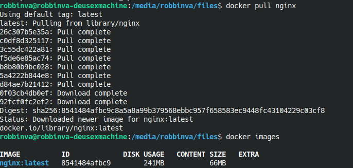

<small>*пик 1: Загрузка докер образа и проверка его наличия*</small>
##### Создай и запусти контейнер на основе образа через `docker run -d [image_id|repository]`.
##### Проверь, что контейнер запустился через `docker ps`.

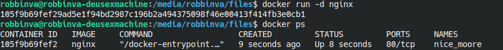

<small>*пик 2: Создание и запуск контейнера на основе его образа и затем проверка его запуска*</small>

##### Посмотри информацию о контейнере через `docker inspect [container_id|container_name]`.
##### По выводу команды определи и помести в отчёт размер контейнера, список замапленных портов и ip контейнера.

Вывод docker inspect

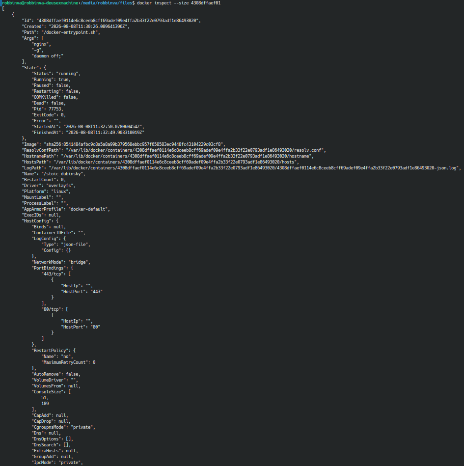
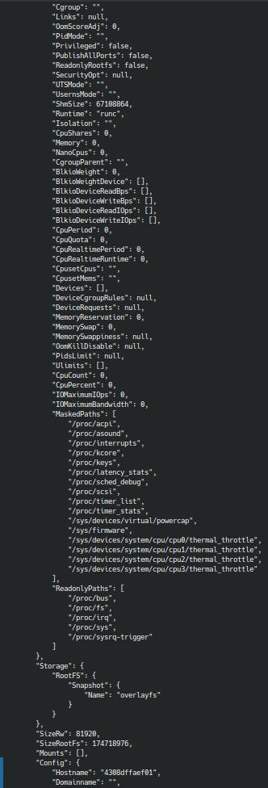
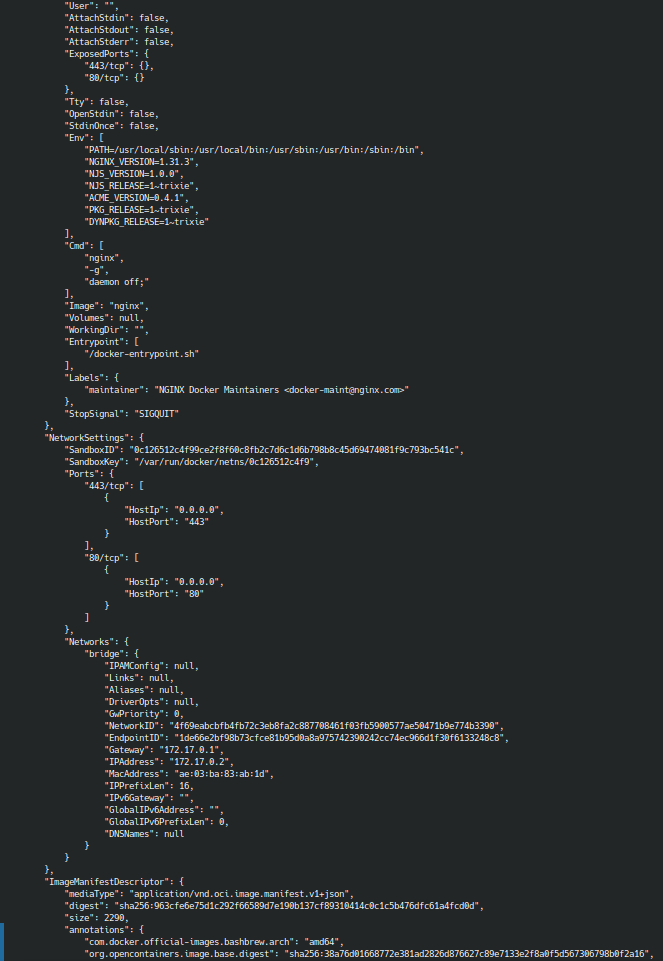
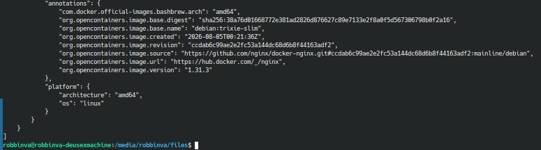

<small>*пикc: Полный вывод doker inspect*</small>

    - размер контйнера 81920 байт = 81,92 килобайта
    - порты не замаплены
    - ip адрес контйнера 172.17.0.2

##### Останови докер контейнер через `docker stop [container_id|container_name]`.
##### Проверь, что контейнер остановился через `docker ps`.
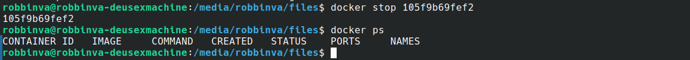

<small>*пик 3: Остановил контйнер и проверил отановку*</small>

##### Запусти докер с портами 80 и 443 в контейнере, замапленными на такие же порты на локальной машине, через команду *run*.
##### Проверь, что в браузере по адресу *localhost:80* доступна стартовая страница **nginx**.

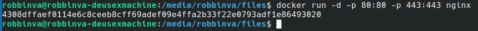

<small>*пик 4: Запустил докер с замапленными портами*</small>

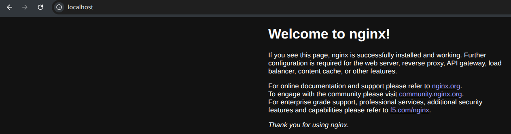

<small>*пик 5: Проверил доуступна ли стартовая страница nginx по адресу localhost:80*</small>

##### Перезапусти докер контейнер через `docker restart [container_id|container_name]`.
##### Проверь любым способом, что контейнер запустился.

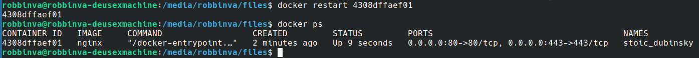

<small>*пик 6: Перезапустил и проверил что контейнер запустился*</small>

## Part 2. Операции с контейнером

##### Прочитай конфигурационный файл *nginx.conf* внутри докер контейнера через команду *exec*.
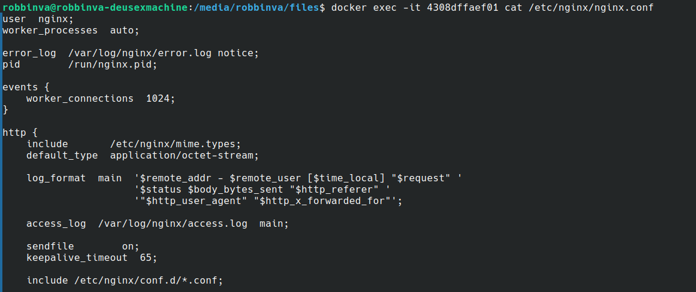

<small>*пик 6: Прочитал содержимое файла nginx.conf в контейнере*</small>
##### Создай на локальной машине файл *nginx.conf*.
##### Настрой в нем по пути */status* отдачу страницы статуса сервера **nginx**.
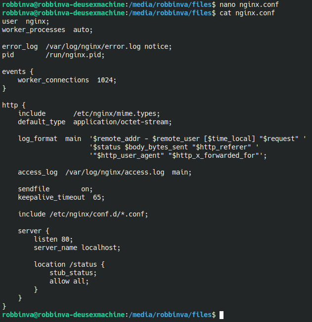

<small>*пик 7: Создал и настроил путь /status в новом конфигурационном файле*</small>
##### Скопируй созданный файл *nginx.conf* внутрь докер-контейнера через команду `docker cp`.
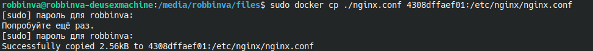

<small>*пик 8: Скопировал созданный файл в контейнер*</small>
##### Перезапусти **nginx** внутри докер-контейнера через команду *exec*.
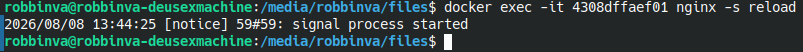

<small>*пик 9: Перезапустил nginx внутри докер-контейнера*</small>
##### Проверь, что по адресу *localhost:80/status* отдается страничка со статусом сервера **nginx**.
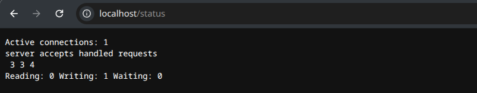

<small>*пик 10: Проверил, что по данному адресу статус сервера отображается*</small>
##### Экспортируй контейнер в файл *container.tar* через команду *export*.
##### Останови контейнер.
##### Удали образ через `docker rmi [image_id|repository]`, не удаляя перед этим контейнеры.
##### Удали остановленный контейнер.
##### Создай образ из файла container.tar через команду *import*.
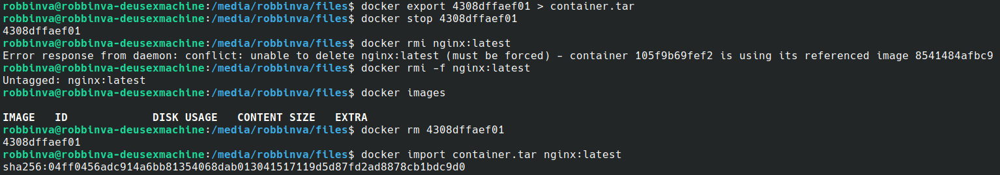

<small>*пик 11: Эксопортировал контейнер, остановил конейнер, удалил образ с флагом -f так как ругался на остановленный
контейнер, удалил контейнер, создал новый образ из архива*</small>
##### Создай и запусти контейнер на основе импортированного образа.
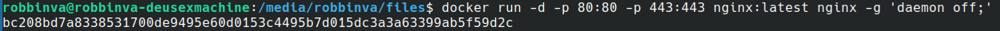

<small>*пик 12: Создал и запустил контейнер с командой nginx -g 'daemon off;' 
так как метаданные CMD и ENTRYPOINT были удалены*</small>

##### Проверь, что по адресу *localhost:80/status* отдается страничка со статусом сервера **nginx**.

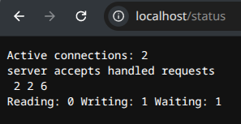

<small>*пик 13: Проверил что статус передается корректно*</small>