## Part 1. Инструмент ipcalc

#### 1.1. Сети и маски

                                    Определил адрес сети
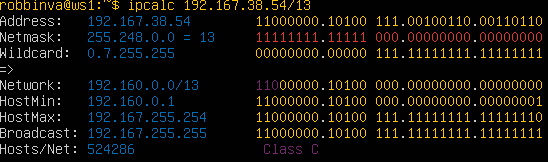

**Перевод маски 255.255.255.0 в префиксную и двоичную запись, /15 в обычную и двоичную, 11111111.11111111.11111111.11110000 в обычную и префиксную**

                                    Перевод маски 255.255.255.0
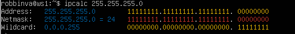

                                    Перевод /15
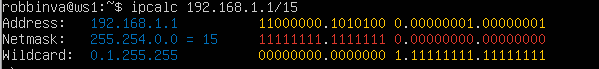

Ручной расчет так как ipcalc не умеет читать:

Префикс: считаем единицы

11111111.11111111.11111111.11110000

8 + 8 + 8 + 4 = 28

"Префикс: /28"
Десятичная: рассчитываем последний октет

11110000 = 128+64+32+16 = 240

Десятичная: 255.255.255.240

**Минимальный и максимальный хост в сети 12.167.38.4 при масках: /8, 11111111.11111111.00000000.00000000, 255.255.254.0 и /4**

                            Min/Max /8
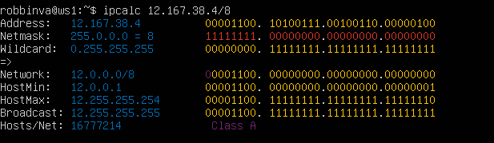

                            Min/Max 11111111.11111111.00000000.00000000
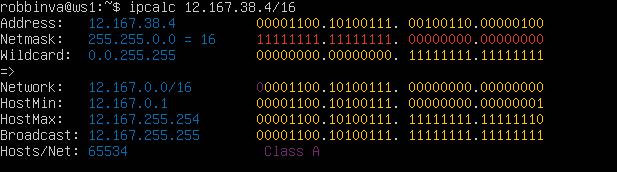

                            Min/Max 255.255.254.0
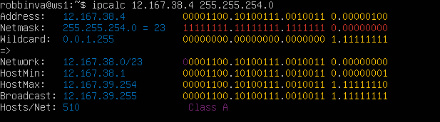

                            Min/Max /4
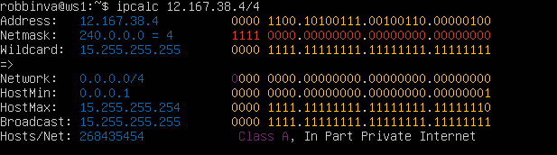

#### 1.2 localhost

**Определи и запиши в отчёт, можно ли обратиться к приложению, работающему на localhost, со следующими IP: 194.34.23.100, 127.0.0.2, 127.1.0.1, 128.0.0.1**

C помощью пинга определял доступность серверов

                            194.34.23.100
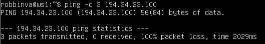

                            127.0.0.2
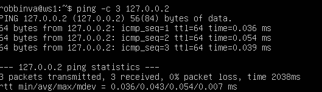

                            127.1.0.1
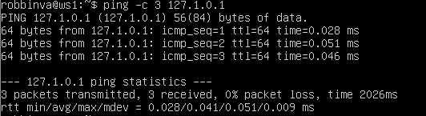

                            128.0.0.1
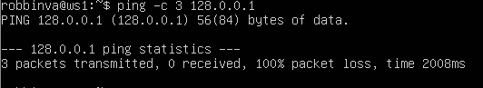

Работают: 127.0.0.2, 127.1.0.1

Не работают: 194.34.23.100, 128.0.0.1 (внешние адреса)

#### 1.3. Диапазоны и сегменты сетей

**Какие из перечисленных IP можно использовать в качестве публичного, а какие только в качестве частных: 10.0.0.45, 134.43.0.2, 192.168.4.2, 172.20.250.4, 172.0.2.1, 192.172.0.1, 172.68.0.2, 172.16.255.255, 10.10.10.10, 192.169.168.1**

                             Определение частный или публичный айпи
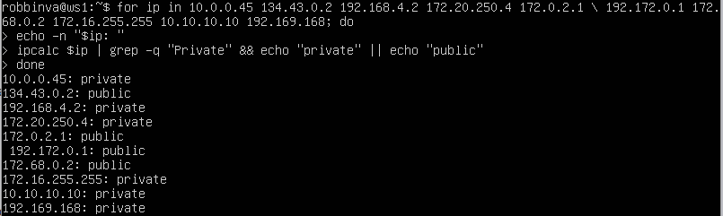

**Какие из перечисленных IP-адресов шлюза возможны у сети 10.10.0.0/18: 10.0.0.1, 10.10.0.2, 10.10.10.10, 10.10.100.1, 10.10.1.255**

                            Определяю минимальный и максимальный хост
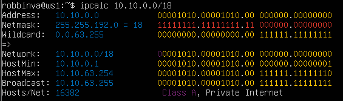

С помощью ipcalc определяю минимальный и максимальный хост, и по данному диапазону определяю какие шлюзы находятся в данной сети:

Диапазон 10.10.0.1 - 10.10.63.254

Может быть шлюзом: 10.10.0.2, 10.10.10.10, 10.10.1.255

Не может: 10.0.0.1, 10.10.100.1

## Part 2. Статическая маршрутизация между двумя машинами

**С помощью команды ip a посмотри существующие сетевые интерфейсы.**

                            Интерфейс ws1
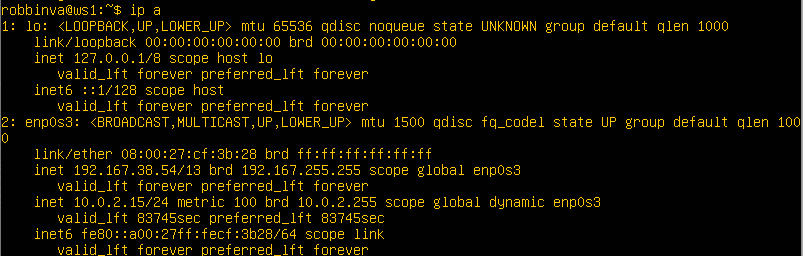

                            Интерфейс ws1
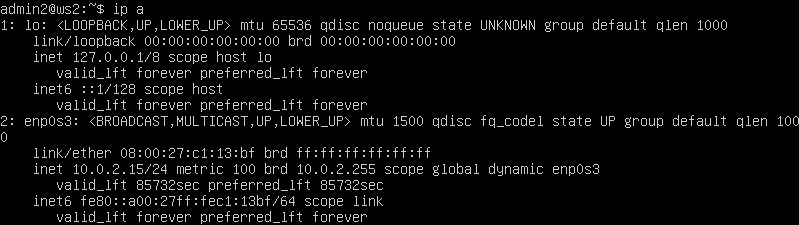

**Опиши сетевой интерфейс, соответствующий внутренней сети, на обеих машинах и задай следующие адреса и маски: ws1 — 192.168.100.10, маска /16, ws2 — 172.24.116.8, маска /12**

Описание сетевого интерфейса.

ws1:

* Интерфейс: enp0s3

* Тип: Ethernet

* MAC-адрес: 08:00:27:cf:3b:28

* адрес: 192.168.100.10/16

* Маска подсети: 255.255.0.0

* Диапазон адресов: 192.168.0.1 — 192.168.255.254

ws2:

* Интерфейс: enp0s3

* Тип: Ethernet

* MAC-адрес: 08:00:27:d1:81:a6

* адрес: 172.24.116.8/12

* Маска подсети: 255.240.0.0

* Диапазон адресов: 172.16.0.1 — 172.31.255.254

***
                            ws1 netplan

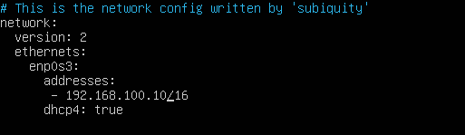

                            ws2 netplan
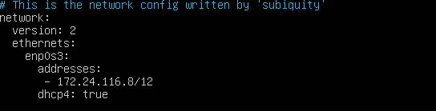

**Выполни команду netplan apply для перезапуска сервиса сети.**

                            netplan apply ws1
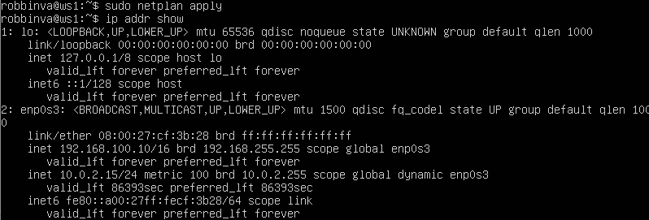

                            netplan apply ws2
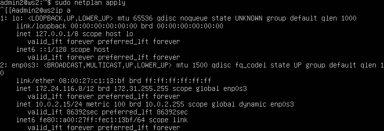

#### 2.1. Добавление статического маршрута вручную

                            ip add r ws1
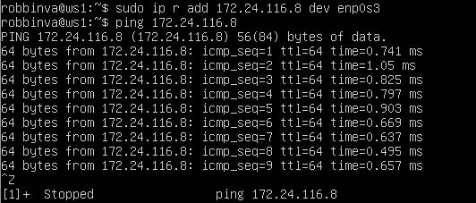

                            ip add r ws2
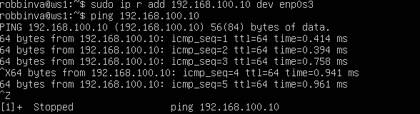

#### 2.2. Добавление статического маршрута с сохранением

                            netplan ws1 route
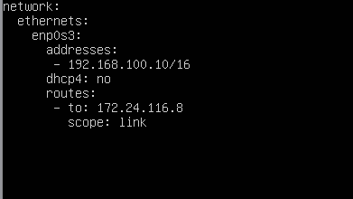

                            ping ws1 to ws2
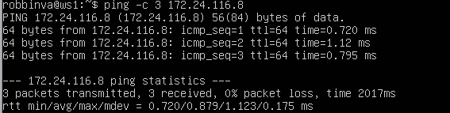

                            netplan ws2 route
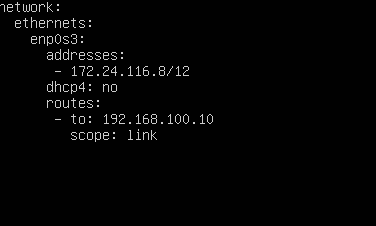

                            ping ws2 to ws1
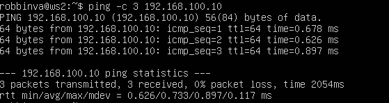                            

## Part 3. Утилита iperf3

#### 3.1. Скорость соединения

**Переведи и запиши в отчёт: 8 Mbps в MB/s, 100 MB/s в Kbps, 1 Gbps в Mbps.**

* 8 мегабит будет 1 мегабайт

* 100 мегабайт будет 800000 килобит

* 1 гигабит будет 100000 мегабит

***

#### 3.2. Утилита iperf3

**Измерь скорость соединения между ws1 и ws2.**

                            iperf3 ws1 server
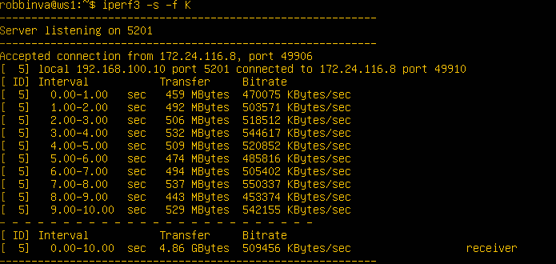

                            iperf3 ws2 client
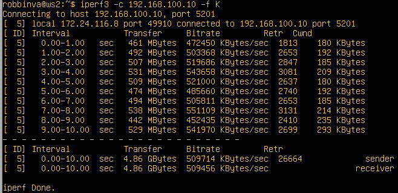

## Part 4. Сетевой экран

#### 4.1. Утилита iptables

                            firewall ws1
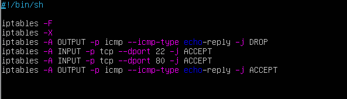

                            firewall ws2
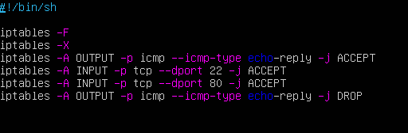

**Запусти файлы на обеих машинах командами chmod +x /etc/firewall.sh и /etc/firewall.sh.**

                            запуск firewall ws1

                            запуск firewall ws2

Так как iptables применяет правила по цепочке с верху вниз, и если при первое совпадение с правилом произошло, то остальные правила в этой цепочке не применяются. То есть на первой машине сначала идет запрещающее правило, и при пинге оно применяется то следующее разрешающее правило не трегерится вовсе. Так и наоборот для второй машине, сначала разрешает пинг, и следующее правило запрещающее не применяется.

#### 4.2. Утилита nmap

                            Проверка пингом и отображение nmap
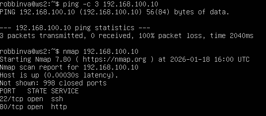

## Part 5. Статическая маршрутизация сети

#### 5.1. Настройка адресов машин

                            ws11 netplan
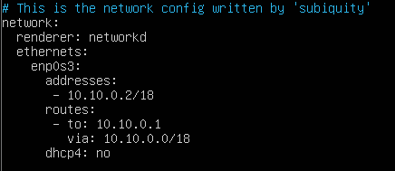

                            r1 netplan
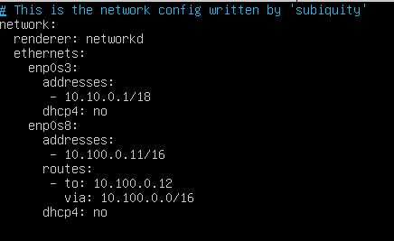

                            r2 netplan
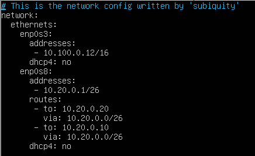

                            ws21 netplan ПОМЕНЯЙ СКРИН
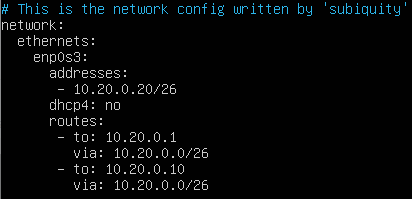

                            ws22 netplan
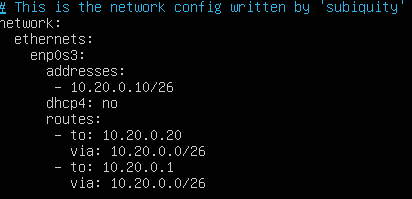

                            ip -4 a ws11
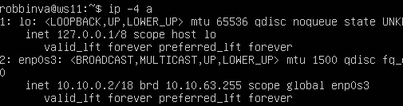

                            ip -4 a r1 + ping ws11
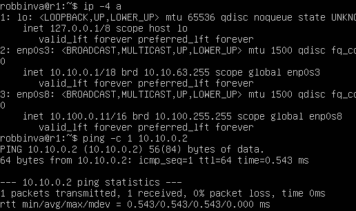

                            ip -4 a r2
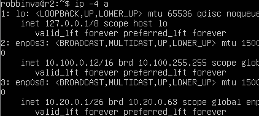

                            ip -4 a ws21
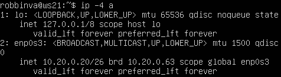

                            ip -4 a ws22 + ping ws21
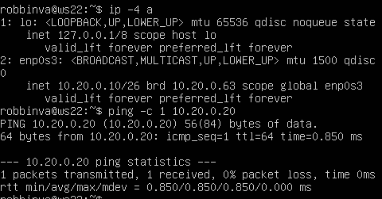

#### 5.2. Включение переадресации IP-адресов

                            r1 forward
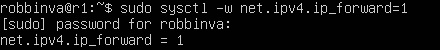

                            r2 forward
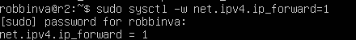

                            sysctl.conf
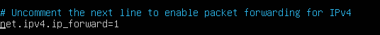

#### 5.3. Установка маршрута по умолчанию

                            default route ws11
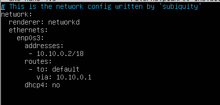

                            default route ws21
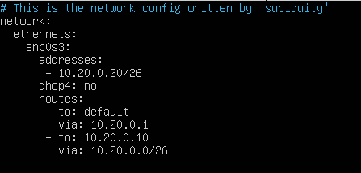

                            default route ws22
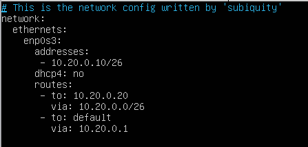

                            ip r default ws11
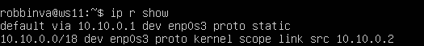

                            ip r default ws21
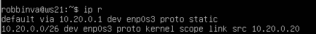

                            ip r default ws22
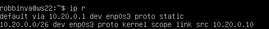

                            tcpdump r2
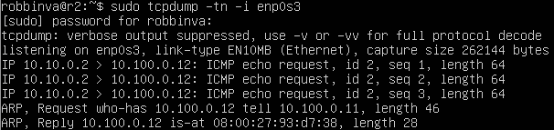

#### 5.4. Добавление статических маршрутов

                            netplan r1

                            netplan r2

                            ip r r1

                            ip r r2

                            ip r list ws11

В данном случае поведение  ip маршрутизации связано с тем, что 10.10.0.0/18 это локальный маршрут, к которой подключен ws11. И он всегда предпочтительнее дефолтного, так как система ищет самую длинную маску. Длина составляет 18 бит и является более точной, поэтому система выбирает именно такой маршрут. А 0.0.0.0/0 по сути может подрузумевать любой адрес, поэтому маршрутизация идет через дефолтный маршрут.

#### 5.5. Построение списка маршрутизаторов

                            traceroute ws11 to ws21

                            tcpdump r1

Построение маршрута с помощью утилиты traceroute происходит следующим образом:

* Отправляются пакеты с TTL равным 1, когда первый пакет достигает r1 то ttl становится равным 1

* Затем отправляются пакеты с TTL равным 2 и так далее пока не достигнет ws21

#### 5.6. Использование протокола ICMP при маршрутизации

                            ping 10.30.0.111

                            dump icmp

## Part 6. Динамическая настройка IP с помощью DHCP

                            r2 dhcpd resolv

**Перезагрузи службу DHCP командой systemctl restart isc-dhcp-server. Машину ws21 перезагрузи при помощи reboot и через ip a покажи, что она получила адрес. Также пропингуй ws22 с ws21.**

                            dhcp restart

                            ip ws21 new

                            ping ws22 to ws21

**Укажи MAC-адрес у ws11, для этого в etc/netplan/00-installer-config.yaml надо добавить строки: macaddress: 10:10:10:10:10:BA, dhcp4: true.**

                            ws11 new netplan

**Для r1 настрой аналогично r2, но сделай выдачу адресов с жесткой привязкой к MAC-адресу (ws11). Проведи аналогичные тесты.**

                            r1 dhcp file

                            r1 resolv file

                            new ip ws11

                            ping ws22 to ws11

**Запроси с ws21 обновление IP-адреса.**

                            old and new ip ws21

В данном заднии использовал две опции:

* sudo dhclient -r enp0s3 (освободил адрес)

* sudo dhclient enp0s3 (запросил новый адрес)

## Part 7. NAT

**В файле /etc/apache2/ports.conf на ws22 и r1 измени строку Listen 80 на Listen 0.0.0.0:80, то есть сделай сервер Apache2 общедоступным.**

                            ports r1

                            ports ws22

**Запусти веб-сервер Apache командой service apache2 start на ws22 и r1.**

                            apache r1

                            apache ws22

**Добавь в фаервол, созданный по аналогии с фаерволом из Части 4, на r2 правила**

**Проверь соединение между ws22 и r1 командой ping.**

                            ping ws22

**Разрешить маршрутизацию всех пакетов протокола ICMP.**

                            ping ws22

Добавил SNAT DNAT правила

                            dnat/snat

**Проверь соединение по TCP для SNAT: для этого с ws22 подключиться к серверу Apache на r1**

                            telnet ws22 to r1

                            telnet r1 to ws22
